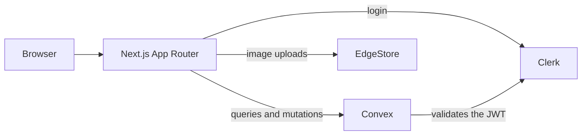

# Jotion - Notion Clone

Jotion is a workspace for notes and documents with a hierarchical structure, block-based editing, and publishing through public links. It is built with Next.js 16, Convex, and Clerk.

The repository contains the full application: authentication, persistence, image uploads, and the public view. There is no sample data and no mocked services.

## Features

**Hierarchical documents.** Each document can have a `parentDocument`. The sidebar shows the tree and supports creating child documents, renaming, archiving, and restoring them.

**Block editor.** BlockNote provides paragraphs, headings, lists, quotes, code, tables, and images. The document is stored as JSON in the `content` field.

**Cover and icon.** Each document can have a cover image uploaded to EdgeStore and an emoji as its icon.

**Trash.** Archiving a document also archives its descendants recursively. The trash lets you search, restore, or permanently delete documents.

**Publishing.** A published document can be opened at `/preview/[documentId]` without signing in. The view is read-only and only works while the document is not archived.

**Search.** `Ctrl + K` (or `Cmd + K` on macOS) opens a title search over non-archived documents.

**Theme.** Light, dark, or system, persisted in `localStorage` under the `jotion-theme` key.

**Navigation.** The sidebar can be collapsed and resized with the mouse. At 768 px or less it is hidden and opened from the menu.

## Stack

| Area           | Technology                                   |
| -------------- | -------------------------------------------- |
| Framework      | Next.js 16 with App Router                   |
| UI             | React 19, Tailwind CSS 4, shadcn/ui on Radix |
| Editor         | BlockNote                                    |
| Backend        | Convex (queries, mutations, schema)          |
| Authentication | Clerk                                        |
| Files          | EdgeStore                                    |
| UI state       | Zustand                                      |
| Themes         | next-themes                                  |
| Notifications  | Sonner                                       |

## Architecture



Next.js organizes the application into three route groups:

| Group         | Route                                   | Access                                                                 |
| ------------- | --------------------------------------- | ---------------------------------------------------------------------- |
| `(marketing)` | `/`                                     | Public. Landing page with sign-in.                                     |
| `(main)`      | `/documents`, `/documents/[documentId]` | Requires a session. The layout redirects to `/` when there is no user. |
| `(public)`    | `/preview/[documentId]`                 | Public, read-only, published documents only.                           |

The authentication and data flow works like this:

1. Clerk authenticates the user and issues a JWT.
2. `ConvexProviderWithClerk` attaches that JWT to every request.
3. `convex/auth.config.ts` validates the token against the configured domain.
4. Every mutation reads `identity.subject` and uses it as `userId`.
5. Before modifying a document, the mutation checks that `document.userId` matches the authenticated user.

## Data model

The only table is `documents`:

| Field            | Type                       | Purpose                                      |
| ---------------- | -------------------------- | -------------------------------------------- |
| `title`          | `string`                   | Title shown in the sidebar and editor.       |
| `userId`         | `string`                   | Clerk `identity.subject`. Defines the owner. |
| `isArchived`     | `boolean`                  | Marks the document as part of the trash.     |
| `parentDocument` | optional `Id<"documents">` | Parent in the document tree.                 |
| `content`        | optional `string`          | BlockNote document serialized as JSON.       |
| `coverImage`     | optional `string`          | Cover image URL in EdgeStore.                |
| `icon`           | optional `string`          | Document emoji.                              |
| `isPublished`    | optional `boolean`         | Enables the public view.                     |

Indexes:

- `by_user`: lists a user's documents.
- `by_user_parent`: resolves a document's children and supports recursive archive and restore.

## Project structure

```text
app/
  (marketing)/          Public landing page and sign-in button
  (main)/               Authenticated area
    _components/        Sidebar, navbar, trash, and publishing
    (routes)/documents/ Document list and editor
  (public)/             Read-only view for published documents
  api/edgestore/        File upload handler
components/
  ui/                   shadcn/ui base components
  modals/               Settings, cover image, and confirmation dialogs
  editor.tsx            BlockNote editor
convex/
  schema.ts             documents table and indexes
  documents.ts          Queries and mutations
  auth.config.ts        Clerk JWT validation
hooks/                  Search, settings, and cover image stores
lib/                    Utilities and EdgeStore client
```

## Getting started

### Requirements

- Node.js 20.9 or newer. This is the minimum version required by Next.js 16.
- npm.
- Accounts on Convex, Clerk, and EdgeStore.

### Installation

```bash
git clone https://github.com/MartinMFM/notion-clone.git
cd notion-clone
npm install
cp .env.example .env.local
```

`cp` works in Git Bash, macOS, Linux, and PowerShell. If you already have a `.env.local`, skip the copy and add only the missing variables.

The next sections fill in that file. `npx convex dev` updates the Convex values automatically; Clerk and EdgeStore need keys from their dashboards.

### Set up Convex

```bash
npx convex dev
```

On the first run, Convex asks you to sign in, creates a development deployment, and generates `convex/_generated`. It also writes `CONVEX_DEPLOYMENT` and `NEXT_PUBLIC_CONVEX_URL` to `.env.local`. Keep this process running while you develop.

### Set up Clerk

1. Create an application in the Clerk dashboard.
2. Create a JWT template named `convex` with the `{"aud": "convex"}` claim. The name must match `applicationID` in `convex/auth.config.ts`.
3. Register the issuer domain in the Convex deployment:

```bash
npx convex env set CLERK_JWT_ISSUER_DOMAIN https://your-instance.clerk.accounts.dev
```

4. Add the Clerk keys to `.env.local`:

```bash
NEXT_PUBLIC_CLERK_PUBLISHABLE_KEY=...
CLERK_SECRET_KEY=...
```

### Set up EdgeStore

1. Create a project in EdgeStore.
2. Copy the keys to `.env.local`:

```bash
EDGE_STORE_ACCESS_KEY=...
EDGE_STORE_SECRET_KEY=...
```

### Environment variables

| Variable                            | Scope   | Purpose                                                                     |
| ----------------------------------- | ------- | --------------------------------------------------------------------------- |
| `CONVEX_DEPLOYMENT`                 | CLI     | Development deployment. Written by `npx convex dev`.                        |
| `NEXT_PUBLIC_CONVEX_URL`            | Next.js | Deployment URL used by `ConvexReactClient`.                                 |
| `NEXT_PUBLIC_CLERK_PUBLISHABLE_KEY` | Next.js | Clerk publishable key.                                                      |
| `CLERK_SECRET_KEY`                  | Next.js | Clerk secret key on the server.                                             |
| `CLERK_JWT_ISSUER_DOMAIN`           | Convex  | Domain validated by `convex/auth.config.ts`. Set with `npx convex env set`. |
| `EDGE_STORE_ACCESS_KEY`             | Next.js | EdgeStore handler.                                                          |
| `EDGE_STORE_SECRET_KEY`             | Next.js | EdgeStore handler.                                                          |

`.env.example` is committed as a reference. `.env.local` is listed in `.gitignore`. Do not commit it.

### Run in development

You need two terminals. Keep Convex running in the first one:

```bash
npx convex dev
```

Start Next.js in the second one:

```bash
npm run dev
```

Open [http://localhost:3000](http://localhost:3000).

### Build for production

```bash
npm run build
npm start
```

The build needs the environment variables above. If you deploy to Vercel, add the same variables to the project and set `CLERK_JWT_ISSUER_DOMAIN` in the production Convex deployment as well.

## Scripts

| Command         | What it does                           |
| --------------- | -------------------------------------- |
| `npm run dev`   | Starts Next.js in development mode.    |
| `npm run build` | Builds the application for production. |
| `npm start`     | Serves the production build.           |
| `npm run lint`  | Runs ESLint.                           |

There is no test script.

## Permissions

All operations go through `convex/documents.ts`. The pattern repeats: read the identity, fetch the document, compare `userId`, and throw an error when they do not match.

`getById` is the only exception. When a document is published and not archived, it returns the document without authentication. In every other case it requires the owner.

Security does not depend on hiding routes in the client. The client can call a mutation, but Convex rejects it when the document does not belong to the user.

## Technical decisions

- **Convex instead of API routes.** Queries subscribe to data and update the UI without manual refetches. The tradeoff is that data logic lives in `convex/` and the project is tied to the provider.
- **BlockNote instead of a custom editor.** It avoids building selection, blocks, and formatting from scratch. The tradeoff is that content is stored in BlockNote's JSON format, and the editor is loaded with `dynamic(..., { ssr: false })` so it does not run on the server.
- **EdgeStore instead of raw S3.** It reduces upload and URL configuration. The tradeoff is that the `publicFiles` bucket is public.
- **Route groups.** They separate the landing page, the application, and the public view without nesting layouts they do not share.
- **`content` as a JSON string.** It keeps the schema simple. The tradeoff is that Convex cannot query the content or compare versions.
